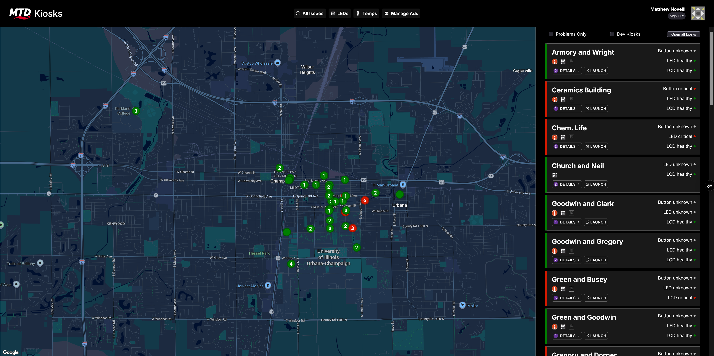
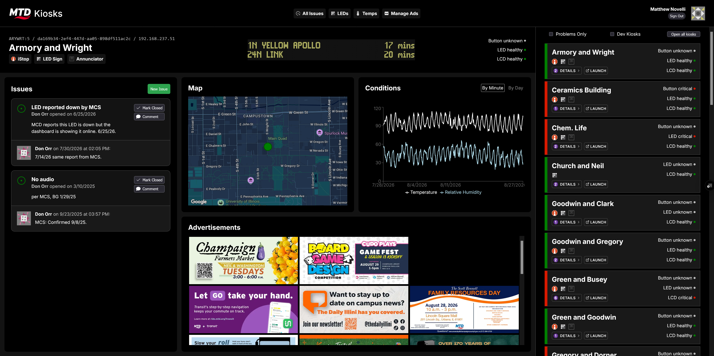
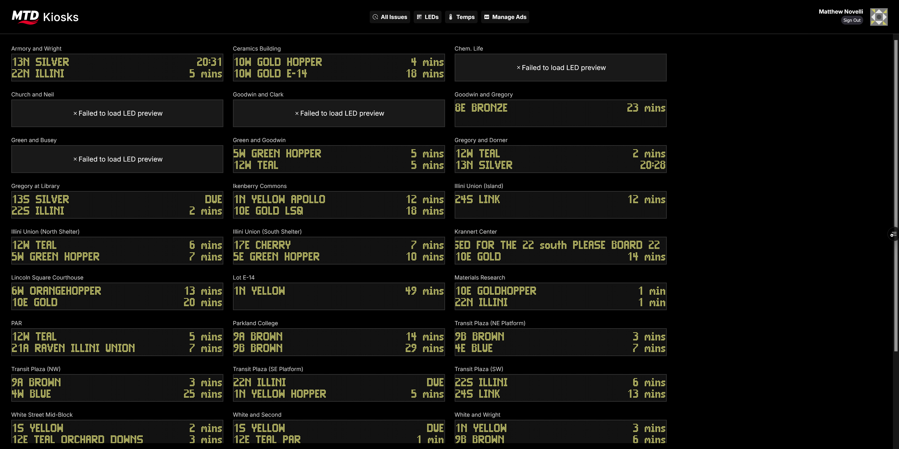

# MTD Kiosk

[](https://github.com/CUMTD/mtd-kiosk/actions/workflows/build.yml)

Next.js app that powers MTD's physical kiosks. It renders the public kiosk displays, provides an admin dashboard for monitoring kiosk health, and hosts a Sanity Studio for managing kiosk content.

## Screenshots






## Sections

The app directory is split into route groups:

- **`(kiosk display)`** (`/kiosks/[slug]`): The full-screen display shown on physical kiosks. Renders real-time departures, general messages, rotating advertisements, icon messages, and a clock. Supports per-kiosk layout classes and automatic dark mode based on time of day.
- **`(kiosk dashboard)`** (`/dashboard`): Internal admin dashboard. Shows kiosk health status, a map of kiosk locations, maintenance tickets/issues, LED sign previews, and temperature history. Protected by Entra ID sign-in.
- **`studio`** (`/studio`): Embedded Sanity Studio for editing kiosks, ads, and messages. (`/umbraco` redirects here.)
- **`api`**: NextAuth routes (`/api/auth`) and a Vercel cron endpoint (`/api/cron`) that updates advertisement statuses based on their start and end dates.

## Technologies

- [Next.js](https://nextjs.org/) (App Router) with React and TypeScript
- [Sanity](https://www.sanity.io/) for content management (kiosks, advertisements, icon messages, kiosk bundles, layout classes)
- [NextAuth](https://next-auth.js.org/) with Microsoft Entra ID for dashboard authentication
- [Jotai](https://jotai.org/) for client state
- [@vis.gl/react-google-maps](https://visgl.github.io/react-google-maps/) for the dashboard map
- [Recharts](https://recharts.org/) for temperature charts
- [Sentry](https://sentry.io/) for error tracking
- Hosted on [Vercel](https://vercel.com/)

Live data (departures, kiosk health, tickets, temperatures, LED previews) comes from the Kiosk API backend, configured via `NEXT_PUBLIC_KIOSK_HEALTH_ENDPOINT`.

## Development

Requires Node >= 20.10.0.

```bash
npm install
npm run dev
```

The app runs at `http://localhost:3000`. You will need a `.env.local` with the environment variables below.

### Other scripts

| Script                 | Purpose                 |
| ---------------------- | ----------------------- |
| `npm run build:next`   | Build the Next.js app   |
| `npm run build:sanity` | Build the Sanity Studio |
| `npm run build:all`    | Build both              |
| `npm run lint`         | Run ESLint              |
| `npm run prettier`     | Format with Prettier    |

[kioskSimulator.py](kioskSimulator.py) simulates kiosk heartbeats against a local Kiosk API instance for testing the health dashboard.

## Environment Variables

### Server

| Variable                 | Purpose                             |
| ------------------------ | ----------------------------------- |
| `AZURE_AD_CLIENT_ID`     | Entra ID app registration           |
| `AZURE_AD_CLIENT_SECRET` | Entra ID client secret              |
| `AZURE_AD_TENANT_ID`     | Entra ID tenant                     |
| `NEXTAUTH_SECRET`        | NextAuth session encryption         |
| `KIOSK_API_KEY`          | `X-ApiKey` header for the Kiosk API |
| `CRON_SECRET`            | Bearer token for `/api/cron`        |
| `SENTRY_AUTH_TOKEN`      | Sentry source map uploads           |

### Client

| Variable                                        | Purpose                        | Default    |
| ----------------------------------------------- | ------------------------------ | ---------- |
| `NEXT_PUBLIC_KIOSK_HEALTH_ENDPOINT`             | Kiosk API base URL             |            |
| `NEXT_PUBLIC_GOOGLE_MAPS_API_KEY`               | Google Maps                    |            |
| `NEXT_PUBLIC_DARK_MODE_MAP_ID`                  | Google Maps dark mode style    |            |
| `NEXT_PUBLIC_SANITY_PROJECT_ID`                 | Sanity project                 |            |
| `NEXT_PUBLIC_SANITY_DATASET`                    | Sanity dataset                 |            |
| `NEXT_PUBLIC_SANITY_API_VERSION`                | Sanity API version             |            |
| `NEXT_PUBLIC_SANITY_API_TOKEN`                  | Sanity read token              |            |
| `NEXT_PUBLIC_AD_FETCH_INTERVAL`                 | Ad refresh interval (ms)       | `3600000`  |
| `NEXT_PUBLIC_AD_ROTATION_INTERVAL`              | Ad carousel rotation (ms)      | `10000`    |
| `NEXT_PUBLIC_DEPARTURES_UPDATE_INTERVAL`        | Departure refresh (ms)         | `15000`    |
| `NEXT_PUBLIC_DEPARTURES_PAGINATION_INTERVAL`    | Departure list pagination (ms) | `10000`    |
| `NEXT_PUBLIC_GENERAL_MESSAGE_UPDATE_INTERVAL`   | General message refresh (ms)   | `15000`    |
| `NEXT_PUBLIC_ICON_MESSAGES_FETCH_INTERVAL`      | Icon message refresh (ms)      | `300000`   |
| `NEXT_PUBLIC_ICON_MESSAGE_PAGINATION_INTERVAL`  | Icon message carousel (ms)     | `15000`    |
| `NEXT_PUBLIC_DARK_MODE_FETCH_INTERVAL`          | Dark mode check (ms)           | `300000`   |
| `NEXT_PUBLIC_HEALTH_FETCH_INTERVAL`             | Dashboard health poll (ms)     | `60000`    |
| `NEXT_PUBLIC_REALTIME_POSITION_UPDATE_INTERVAL` | Vehicle position refresh (ms)  | `5000`     |
| `NEXT_PUBLIC_ROUTE_POLYLINES_FETCH_INTERVAL`    | Route polyline refresh (ms)    | `86400000` |
| `NEXT_PUBLIC_GBFS_MESSAGE_UPDATE_INTERVAL`      | GBFS message refresh (ms)      | `60000`    |

## Deployment

Deployed to Vercel. [vercel.json](vercel.json) schedules the ad status cron (`/api/cron`) every 59 minutes from 7 AM to 6 PM.
